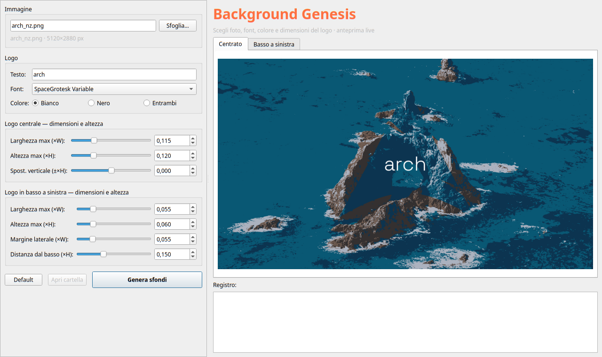

# Background Genesis

Desktop wallpaper generator with a text logo overlay. It produces two versions
of every wallpaper: a **centered** logo and a **bottom-left** logo raised above
the taskbar. Available as a Plasma-style graphical app and as a CLI script.



## Features

- Live preview of both variants (centered / bottom-left)
- Custom text, font and color (white, black, or both)
- Logo size control: max width *and* max height, vertical offset,
  side margin and bottom margin
- High-quality JPEG output (quality 95, no chroma subsampling)

## Installation

Requirements: Python 3.10+, Pillow, PySide6.

```bash
python3 -m venv .venv
source .venv/bin/activate
pip install Pillow PySide6
```

No installation needed beyond that: run everything from this folder.

## Usage

### Graphical app

```bash
python3 qutec_sfondi_gui.py [photo.jpg]
```

Pick a photo with **Browse**, adjust text, font, color and sizes while watching
the live preview, then press **Generate**. The output folder opens automatically
in the default file manager, and the confirmation dialog lists the created files.

Run `./"add to app.sh"` to add Background Genesis to the Plasma application
menu (no root needed). A portable `background-genesis.desktop` template is also
included for system-wide packaging and *Open With* in Dolphin.

### Command line

```bash
python3 crea_sfondi_qutec.py photo.jpg --font fonts/SpaceGrotesk-Variable.ttf -w
python3 crea_sfondi_qutec.py photo.jpg --font fonts/Montserrat-Variable.ttf -b
```

| Option            | Type              | Default      | Description                                              |
|-------------------|-------------------|--------------|----------------------------------------------------------|
| `image`           | Path (required)   | —            | Source image (JPG, PNG, WebP, …)                         |
| `--font`          | Path              | System fallback | Logo font (TTF, OTF, WOFF2)                           |
| `--text`          | String            | `QuTec`      | Text drawn on both variants                              |
| `-w` / `-b`       | Flag (exclusive)  | `-w`         | White (`#FFFFFF`) / black (`#000000`) logo               |
| `--center-size`   | Float (0–1)       | `0.115`      | Centered logo max width, as canvas-width fraction        |
| `--corner-size`   | Float (0–1)       | `0.055`      | Bottom-left logo max width, as canvas-width fraction     |
| `--margin`        | Float (0–0.5)     | `0.055`      | Left/right margin, as width fraction                     |
| `--bottom-margin` | Float (0–0.5)     | `0.15`       | Lift above the taskbar, as height fraction               |

The GUI adds two extra constraints the CLI does not have: max logo
**height** (as canvas-height fraction) and **vertical offset** of the centered
logo.

### Output

Saved next to the source image:

- `<name>_qutec_centro.jpg` — centered logo (desktop / splash)
- `<name>_qutec_basso_sinistra.jpg` — bottom-left logo, raised for the taskbar

## License & fonts

Code is released under the **MIT License** (see `LICENSE`).

Bundled fonts under `fonts/` (Space Grotesk, Montserrat, IBM Plex Sans,
Inter Tight, Manrope, Sora) are released under the **SIL Open Font License 1.1**
and are redistributable.
